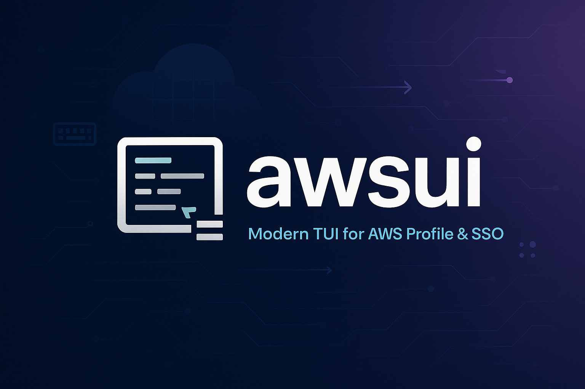
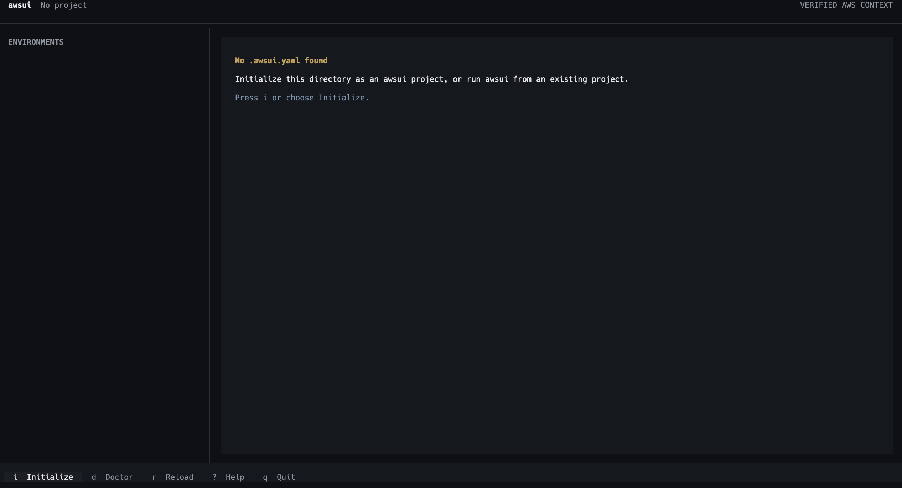

# awsui

<p align="center">
  
</p>

<p align="center">
  <a href="https://pypi.org/project/awsui/"></a>
  <a href="https://opensource.org/licenses/MIT"></a>
  <a href="https://textual.textualize.io/"></a>
</p>

<p align="center">
  <a href="#"></a>
  <a href="README_ZH_TW.md"></a>
</p>

<p align="center">
  <a href="https://junminhong.github.io/awsui/">Website</a>
</p>

<h3 align="center">
  Stop telling your AI which AWS profile to use.<br>
  Run Claude Code, Codex, Kiro, Terraform, and any CLI in the right verified AWS context.
</h3>

You think in environments like `dev` and `prod`. AWS tools expect profile names
like `company-payment-production-admin`. awsui connects the two, verifies the
real AWS account, and only then hands control to your tool.



## What awsui does for you

You choose the environment. awsui takes care of the context around it:

- You type `prod`, not a machine-specific profile name.
- You see the real account returned by STS before anything starts.
- Your AI agent, Terraform, AWS CLI, scripts, and shell all use the same context.
- Your team shares account and region intent without sharing local profile names.
- Your command never starts when authentication fails or the account does not match.

> [!IMPORTANT]
> awsui provides a verified AWS launch context, not a security sandbox. A child
> process can intentionally replace its inherited environment or select another
> profile explicitly.

## Take awsui for a first run

By the end of these four steps, you will have a project context, a verified AWS
identity, and a tool running inside it.

### Before you start

You need Python 3.13, [AWS CLI v2](https://docs.aws.amazon.com/cli/latest/userguide/getting-started-install.html),
and an AWS profile configured through AWS CLI. IAM Identity Center (SSO) is the
recommended authentication method.

### 1. Install awsui

Install it as an isolated tool with [uv](https://docs.astral.sh/uv/):

```bash
uv tool install --python 3.13 awsui
```

Prefer pip? Install it in your current Python environment instead:

```bash
pip install awsui
```

Now make sure the command is available:

```bash
awsui --version
```

If awsui prints the installed version, you are ready for the project setup.

### 2. Set up your project contexts

Move into your project and start the guided setup:

```bash
cd payment-service
awsui init
```

awsui asks you to name the project, add environments, choose or create a local
profile, and verify each identity. When setup finishes, you will see a summary
like this:

```text
Created /path/to/payment-service/.awsui.yaml
Project: payment-service
  dev: 111111111111 · ap-northeast-1
  prod: 999999999999 · ap-northeast-1 · PROTECTED
```

**What just happened?** awsui wrote the shared account and region intent to
`.awsui.yaml`, while keeping your machine-specific profile bindings outside the
repository.

### 3. Verify the environment you are about to use

Before launching anything, ask awsui to show you the real identity behind
`prod`:

```bash
awsui context prod
```

The plain-text result contains the values that matter:

```text
payment-service · PROD · PROTECTED
Expected account: 999999999999
Authenticated account: 999999999999
Region: ap-northeast-1
Local profile: company-payment-prod
Status: ✓ VERIFIED
```

Check that the expected and authenticated accounts match. `VERIFIED` means the
context is ready; it does not launch a child process yet.

### 4. Launch your tool

Now start whichever tool you want to bring:

```bash
awsui prod -- codex
awsui prod -- claude
awsui prod -- terraform plan
```

Immediately before launch, awsui verifies the identity again and shows the
context it is handing to the process:

```text
payment-service · PROD · PROTECTED
Account: 999999999999 ✓
Region: ap-northeast-1
Launching: codex
```

If the authenticated account is wrong, you will see `AWS CONTEXT MISMATCH` and
`Command was not started.` The tool never receives the incorrect context.

You are set. Run `awsui` whenever you prefer the visual Context Dashboard, or
use `awsui dev` to open a verified interactive shell.

Bringing a teammate onboard? They reuse the committed project intent and bind
`prod` to their own local profile:

```bash
awsui bind prod
awsui prod -- claude
```

## What your team shares

Your team agrees on the expected account and region for each environment, then
commits that shared intent as `.awsui.yaml`:

```yaml
version: 1
project: payment-service
contexts:
  dev:
    account: "111111111111"
    region: ap-northeast-1
  qa:
    account: "222222222222"
    region: ap-northeast-1
  staging:
    account: "333333333333"
    region: ap-northeast-1
  prod:
    account: "999999999999"
    region: ap-northeast-1
    protected: true
```

Your teammate gets the same environment names and account guardrails without
needing your profile name. awsui stores each machine's private bindings outside
the repository in `~/.config/awsui/bindings.json`; `.awsui.yaml` must never
contain credentials.

## Prefer a visual workflow?

Run `awsui` inside your project. You can inspect every environment without
making an AWS request, then verify or launch with the keyboard. Launch and Shell
always verify the identity again immediately before starting the child process.

When no project exists, **Initialize** opens a full-screen setup wizard. You can
name the project, add environments, select or create local profiles, verify each
identity with STS, and review the result before writing any configuration.

| Key | Action |
| --- | --- |
| `↑` / `↓` | Select an environment |
| `Enter` / `v` | Authenticate and verify with STS |
| `b` | Bind a local profile |
| `l` | Launch an AI agent, CLI, or custom command |
| `s` | Open a verified context shell |
| `d` | Run local diagnostics |
| `r` | Reload project and profile state |
| `i` | Initialize when no project exists |
| `?` | Show help |
| `q` | Quit |

The Dashboard distinguishes `UNBOUND`, `PROFILE MISSING`, `READY TO VERIFY`,
`VERIFYING`, `VERIFIED`, `MISMATCH`, and `ERROR`. Protected environments
are visually emphasized and still require an explicit launch action.

## Prefer direct commands?

You can do everything from the command line too:

| Command | Purpose |
| --- | --- |
| `awsui` | Open the Context Dashboard |
| `awsui init` | Initialize verified contexts for a project |
| `awsui bind <environment>` | Bind an environment to a local AWS profile |
| `awsui bind ls` | List project environments and local binding status without authenticating |
| `awsui bind ls --json` | Output the local binding list as JSON |
| `awsui context ls` | List project contexts and local binding status without authenticating |
| `awsui context ls --json` | Output the local context list as JSON |
| `awsui context <environment>` | Authenticate, verify, and display a context |
| `awsui context <environment> --json` | Output the verified context as JSON |
| `awsui <environment> -- <command> [args...]` | Run a child command after verification |
| `awsui <environment>` | Open a verified interactive shell |
| `awsui doctor` | Diagnose local configuration without authenticating |

Use `awsui context ls`/`list` or `awsui bind ls`/`list` to see the configured
account, region, protected marker, and local profile status for every context.
These are local read-only listings; use `awsui context <environment>` when you
want to authenticate and verify one context with STS.

The explicit forms remain available:

```bash
awsui run prod -- codex
awsui shell prod
```

The Dashboard custom-command field accepts a command and arguments, not shell
syntax. Pipes, redirects, `&&`, and other shell operators are rejected; open a
verified shell when shell composition is required.

## Need a new AWS profile?

Choose **Create profile** during initialization or binding when the profile you
need does not exist. IAM Identity Center (SSO) is the recommended first option.
awsui delegates profile creation to the official `aws configure sso`,
`aws login`, or `aws configure` command, then returns to the same workflow and
selects the new profile.

You can also configure SSO before opening awsui:

```bash
aws configure sso
aws sso login --profile my-company-dev
aws sts get-caller-identity --profile my-company-dev
```

AWS Console Login and access-key configuration are also available. Access keys
are marked as not recommended. awsui uses credentials managed by AWS CLI and
does not store AWS credentials itself.

## What happens before every launch?

Here is exactly what awsui does before it starts your process:

1. Resolves the project environment and local profile binding.
2. Authenticates the selected profile when required.
3. Calls STS `GetCallerIdentity`.
4. Compares the actual and expected 12-digit AWS account IDs.
5. Builds a sanitized child environment.
6. Starts the process only after the accounts match.

Account mismatch and unverifiable identity both block execution. Shared project
configuration never contains access keys, secret keys, session tokens, or local
profile names.

## Need help or want to contribute?

Found a bug, have a question, or want to suggest a feature? Open a
[GitHub Issue](https://github.com/junminhong/awsui/issues). If you want to build
the change, pull requests are welcome too.

Set up a development checkout:

```bash
git clone https://github.com/junminhong/awsui.git
cd awsui
uv sync
```

Before opening a pull request, run:

```bash
uv run ruff check .
uv run pytest
uv build
```

## License

[MIT](LICENSE)
