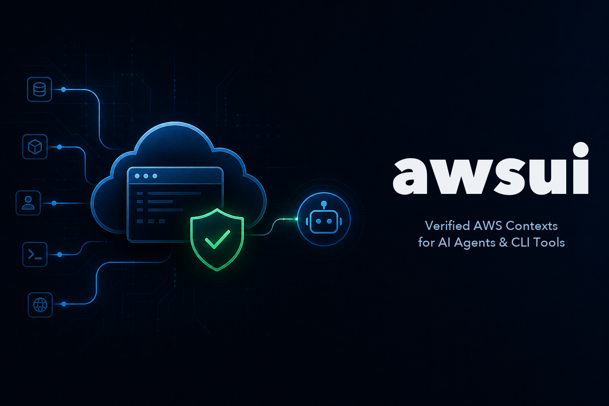
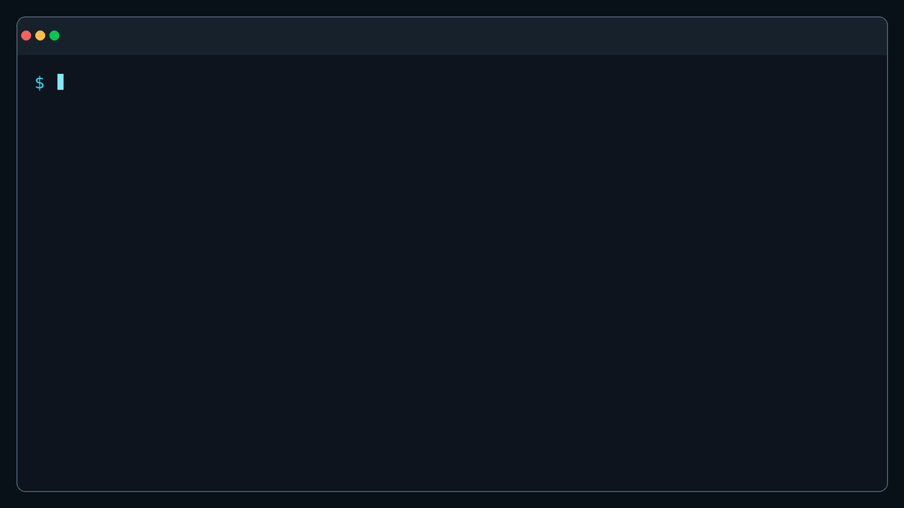

# awsui

<p align="center">
  
</p>

<p align="center">
  <a href="https://pypi.org/project/awsui/"></a>
  <a href="https://opensource.org/licenses/MIT"></a>
</p>

<p align="center">
  <a href="#"></a>
  <a href="README_ZH_TW.md"></a>
</p>

<p align="center">
  <a href="https://junminhong.github.io/awsui/">Website</a>
</p>

<h3 align="center">
  Stop wiring machine-specific AWS profile names into every command.<br>
  Choose an environment, verify the account, and launch Claude Code, Codex, Kiro, Terraform, or any CLI in the right AWS context.
</h3>

You work in environments such as `dev`, `staging`, and `prod`. AWS tools work
with profile names such as `company-payment-production-admin`. awsui maps the
project environment to a local AWS profile, verifies the authenticated account,
and launches your tool only when the account matches the project configuration.



_Initialize the project, bind a profile, verify the account, and launch a tool._

## What problem does awsui solve?

You choose the environment. awsui handles the context checks behind it:

- Work with project environment names such as `prod`, not profile names that vary
  from one machine to another.
- See the account returned by AWS STS before a tool starts.
- Run AI agents, Terraform, AWS CLI, scripts, and shells in the same verified
  context.
- Share the expected account and region for each environment while keeping
  profile bindings local.
- Stop before launch when authentication fails or the account does not match.

> [!IMPORTANT]
> awsui verifies the AWS context at launch time; it is not a security sandbox.
> After launch, a child process can still replace inherited environment variables
> or explicitly select another profile.

## Quick start

Complete these four steps to define a project context, verify the AWS identity,
and launch a tool inside that context.

### Before you start

Install Python 3.13 and [AWS CLI v2](https://docs.aws.amazon.com/cli/latest/userguide/getting-started-install.html),
then configure at least one AWS profile through AWS CLI. IAM Identity Center
(SSO) is the recommended authentication method.

### 1. Install awsui

The recommended option is an isolated installation with
[uv](https://docs.astral.sh/uv/):

```bash
uv tool install --python 3.13 awsui
```

You can also install awsui in the current Python environment with pip:

```bash
pip install awsui
```

Verify the installation:

```bash
awsui --version
```

If awsui prints a version number, the installation is ready.

CLI output defaults to English. To switch to Traditional Chinese and save the
preference, run:

```bash
awsui --lang zh-TW
```

Run `awsui --lang en` to switch back. The option can also precede another
command, as in `awsui --lang zh-TW context prod`. awsui stores only the language
preference in `~/.config/awsui/settings.json`; the file contains no AWS
credentials. If the settings file is invalid, explicitly setting `--lang` again
recreates it.

### 2. Initialize the project context

Move into the project directory and start the guided setup:

```bash
cd payment-service
awsui init
```

awsui prompts you to name the project, add environments, choose or create a
local profile, and verify each AWS identity. When setup finishes, it displays a
summary like this:

```text
Created /path/to/payment-service/.awsui.yaml
Project: payment-service
  dev: 111111111111 · ap-northeast-1
  prod: 999999999999 · ap-northeast-1 · PROTECTED
```

awsui writes the shared environments, accounts, and regions to `.awsui.yaml`.
Machine-specific profile bindings remain outside the repository.


_Create the shared project contexts from the terminal._

### 3. Verify the environment you are about to use

Before launching a tool, check which AWS identity is actually behind `prod`:

```bash
awsui context prod
```

The output shows both the expected and authenticated accounts:

```text
payment-service · PROD · PROTECTED
Expected account: 999999999999
Authenticated account: 999999999999
Region: ap-northeast-1
Local profile: company-payment-prod
Status: ✓ VERIFIED
```

Confirm that the expected and authenticated accounts match. `VERIFIED` means
the context is available; this command reports the result without launching a
child process.


_Confirm the authenticated AWS account before launching a tool._

### 4. Launch your tool

Once the context is ready, launch the tool you need:

```bash
awsui prod -- codex
awsui prod -- claude
awsui prod -- terraform plan
```

Immediately before launch, awsui verifies the identity again and displays the
context that the child process will receive:

```text
payment-service · PROD · PROTECTED
Account: 999999999999 ✓
Region: ap-northeast-1
Launching: codex
```

If the account does not match the project configuration, awsui displays
`AWS CONTEXT MISMATCH` and `Command was not started.`, then stops without
launching the command.


_awsui launches Codex only after the selected context passes verification._

Run `awsui --help` to see every command. To open an interactive shell with a
verified context, run `awsui dev`.

After another developer checks out the repository, they only need to bind the
shared `prod` environment to a profile on their machine:

```bash
awsui bind prod
awsui prod -- claude
```


_Each developer binds the shared environment name to a local profile._

## What the team commits and what stays local

Record the expected account and region for each environment in `.awsui.yaml`,
then commit that file to the repository:

```yaml
version: 1
project: payment-service
contexts:
  dev:
    account: "111111111111"
    region: ap-northeast-1
  qa:
    account: "222222222222"
    region: ap-northeast-1
  staging:
    account: "333333333333"
    region: ap-northeast-1
  prod:
    account: "999999999999"
    region: ap-northeast-1
    protected: true
```

Every developer uses the same environment names and account validation rules
without sharing profile names. awsui stores machine-specific bindings outside
the repository in `~/.config/awsui/bindings.json`. Never put credentials in
`.awsui.yaml`.

## Command reference

These are the primary CLI commands:

| Command | Purpose |
| --- | --- |
| `awsui` | Show CLI help |
| `awsui --lang <zh-TW\|en>` | Set and remember the CLI language |
| `awsui init` | Initialize project contexts |
| `awsui bind <environment>` | Bind an environment to a local AWS profile |
| `awsui bind ls` | List environments and local bindings without contacting AWS |
| `awsui bind ls --json` | Output the local binding list as JSON |
| `awsui context ls` | List contexts and local bindings without contacting AWS |
| `awsui context ls --json` | Output the local context list as JSON |
| `awsui context <environment>` | Authenticate, verify, and display a context |
| `awsui context <environment> --json` | Output the verified context as JSON |
| `awsui <environment> -- <command> [args...]` | Run a child command after verification |
| `awsui <environment>` | Open a verified interactive shell |
| `awsui doctor` | Diagnose local configuration without signing in |

`awsui context ls`/`list` and `awsui bind ls`/`list` only read local
configuration; they do not contact AWS. They show the expected account, region,
protection status, and local profile for each context. Run
`awsui context <environment>` when you need to verify a specific context with
STS.

The explicit forms are also available:

```bash
awsui run prod -- codex
awsui shell prod
```

Content after `--` is launched directly as an argument vector without shell
parsing. For pipes, redirects, `&&`, or other shell syntax, first open a verified
shell with `awsui <environment>`, then run the composed command inside it.

## Need a new AWS profile?

If the profile you need does not exist, choose **Create new AWS profile** during
initialization or binding. IAM Identity Center (SSO) is the recommended first
option. awsui starts the official `aws configure sso`, `aws login`, or
`aws configure` workflow, then returns and selects the new profile.

You can also configure and verify an SSO profile before running awsui:

```bash
aws configure sso
aws sso login --profile my-company-dev
aws sts get-caller-identity --profile my-company-dev
```

AWS Console Login and access-key configuration are also available, but
long-lived access keys are not recommended. awsui uses credentials managed by
AWS CLI and does not store AWS credentials itself.

## How does awsui verify a launch context?

Before every launch, awsui performs the following steps:

1. Resolves the project environment and its local profile binding.
2. Authenticates the selected profile when required.
3. Calls STS `GetCallerIdentity`.
4. Compares the authenticated account with the expected 12-digit AWS account ID.
5. Builds a child environment with credential overrides removed.
6. Starts the child process only when the accounts match.

An account mismatch or unverifiable identity stops the launch. Shared project
configuration contains no access keys, secret keys, session tokens, or local
profile names.

## Need help or want to contribute?

If you find a bug, have a question, or want to suggest a feature, open a
[GitHub Issue](https://github.com/junminhong/awsui/issues). Pull requests are
also welcome.

Set up a local development environment:

```bash
git clone https://github.com/junminhong/awsui.git
cd awsui
uv sync
```

Before opening a pull request, run:

```bash
uv run ruff check .
uv run pytest
uv build
```

## License

[MIT](LICENSE)
